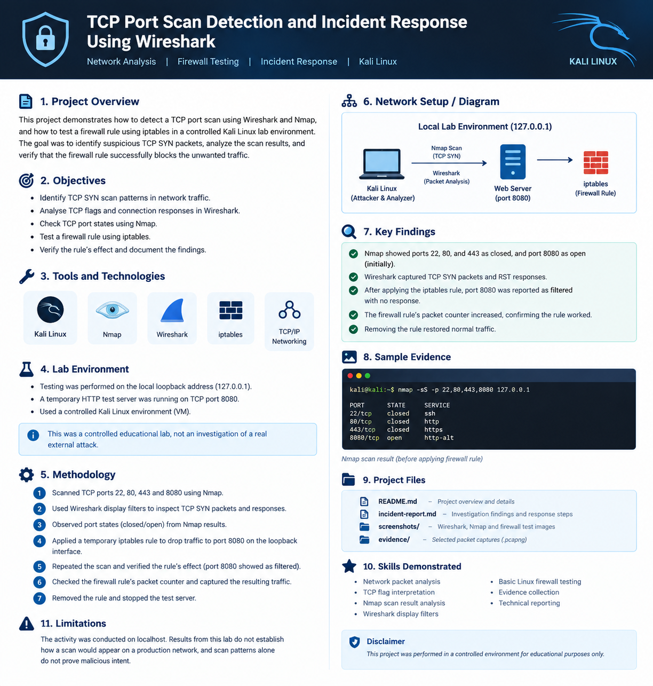

# TCP Port Scan Detection and Incident Response Using Wireshark




## 📌 Project Overview

This project demonstrates how to identify TCP SYN scan activity, analyse network packets using Wireshark, and test a firewall rule using iptables in a controlled Kali Linux lab.

I used Nmap to scan local TCP ports, Wireshark to capture and analyse network traffic, and iptables to test a temporary firewall rule. I then performed another scan to verify the effect of the firewall rule and documented the results.

This project helped me practise network traffic analysis, TCP connection behaviour, basic firewall testing, evidence collection, and technical reporting.

## 🎯 Project Objectives

- Identify TCP SYN scan patterns in network traffic.
- Understand TCP flags and connection responses.
- Analyse packet captures using Wireshark.
- Identify open, closed, and filtered TCP ports using Nmap.
- Test a firewall rule using Linux iptables.
- Verify the firewall rule through a follow-up scan.
- Document investigation findings and supporting evidence.

## 🛠️ Tools and Technologies

| Tool | Purpose |
|---|---|
| Kali Linux | Lab environment |
| Nmap | TCP port scanning |
| Wireshark | Network packet capture and analysis |
| iptables | Linux firewall rule testing |
| TCP/IP | Understanding network communication |

## 🧪 Lab Environment

- **Operating environment:** Kali Linux running in VMware
- **Target IP:** `127.0.0.1` (localhost)
- **Test service:** Python HTTP server
- **Test port:** TCP `8080`
- **Ports scanned:** `22`, `80`, `443`, and `8080`

All activities were performed on my own local lab system for educational purposes.

## 🔍 Investigation Methodology

### Step 1: Generate TCP Scan Traffic

I used Nmap to scan four TCP ports on the local system.

```bash
nmap -sS -p 22,80,443,8080 127.0.0.1
```

The purpose was to observe how different ports respond to TCP SYN probes.

### Step 2: Capture and Analyse Packets

I used Wireshark to capture the traffic on the loopback interface and inspect TCP flags and connection responses.

**Display filter to identify TCP SYN packets:**

```text
tcp.flags.syn == 1 && tcp.flags.ack == 0
```

**Display filter to view TCP reset and SYN packets:**

```text
tcp.flags.reset == 1 || tcp.flags.syn == 1
```

These filters helped me identify connection attempts and understand how the tested ports responded.

### Step 3: Identify Port States

The initial Nmap scan showed the following results:

| TCP Port | Initial State | Observation |
|---|---|---|
| 22 | Closed | No service was listening |
| 80 | Closed | No service was listening |
| 443 | Closed | No service was listening |
| 8080 | Open | The test HTTP server was listening |

These results describe the behaviour observed in my local lab.

### Step 4: Test a Firewall Rule

I applied a temporary iptables rule to drop incoming TCP traffic destined for port 8080 on the loopback interface.

```bash
sudo iptables -I INPUT 1 -i lo -p tcp --dport 8080 -j DROP
```

The purpose was to test how a firewall rule changes the observed network behaviour.

### Step 5: Verify the Firewall Rule

I performed another scan of port 8080 and checked the firewall rule's packet counter.

The follow-up Nmap scan reported port 8080 as **filtered**, with no response received during the test.

Wireshark captured SYN packets without replies, and the firewall packet counter increased. These observations were consistent with the firewall rule dropping the tested traffic.

### Step 6: Clean Up the Lab

After completing the test, I removed the temporary firewall rule and stopped the Python HTTP server.

This returned the lab to its previous configuration.

## 📊 Key Findings

- Identified TCP SYN scan patterns in captured network traffic.
- Observed TCP reset responses from closed ports.
- Confirmed that port 8080 was initially open.
- Tested a temporary firewall rule using iptables.
- Observed the port change from open to filtered during the firewall test.
- Verified matching traffic through the firewall packet counter.
- Collected packet captures, screenshots, and an investigation report.

## 📁 Project Files

| File | Description |
|---|---|
| `README.md` | Project overview, methodology, and findings |
| `incident-report.md` | Investigation report and response steps |
| `tcp-port-scan-investigation.pcapng` | Network packet capture |
| `tcp-port-scan-syn-filter.pcapng` | Packet capture for SYN traffic analysis |
| `firewall-blocked-traffic.pcapng` | Traffic captured during the firewall test |
| `firewall-test-nmap-result.png` | Screenshot of Nmap test results |
| `firewall-drop-rule.png` | Screenshot of firewall rule evidence |

Only include the files listed above if they are present in your repository. Other relevant screenshots or packet captures can also be included.

## 💡 Skills Demonstrated

- Network traffic analysis
- TCP flags and connection behaviour
- Nmap port scanning and result interpretation
- Wireshark display filters
- Linux command-line basics
- Firewall rule testing with iptables
- Security evidence collection
- Incident documentation and technical reporting

## ⚠️ Limitations

This project was performed on localhost rather than a production network. The results demonstrate a controlled lab exercise and should not be treated as proof of a real cyberattack.

A TCP SYN scan pattern alone does not establish malicious intent. Network context and additional evidence are needed to determine whether activity is suspicious.

## 🚀 Future Improvements

- Analyse scan patterns using Zeek or a SIEM platform.
- Create detection rules for repeated connection attempts.
- Investigate traffic from multiple systems in an isolated lab.
- Develop a repeatable incident investigation checklist.
- Document additional detection and response scenarios.

## 📌 Disclaimer

This project was created for educational purposes in a controlled local lab. All testing was performed on my own system. It does not represent an investigation of a real external attack.

---

**Author:** Pooja Yadav  
**Focus:** Cybersecurity | Network Security | SOC Analyst Learning Path
